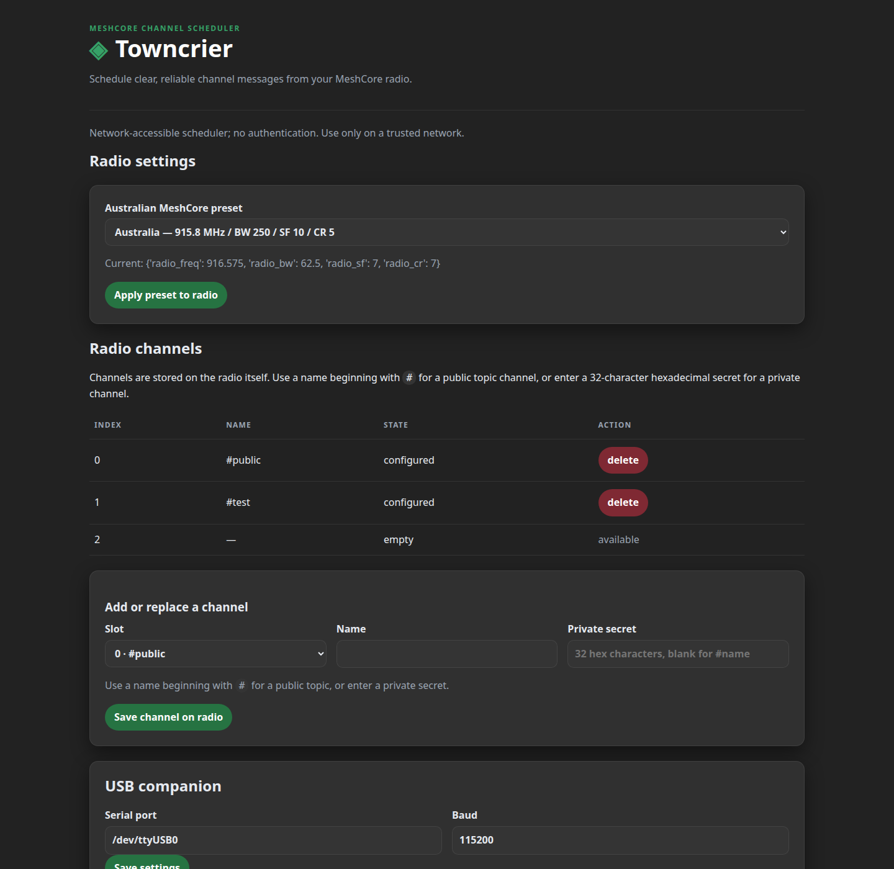
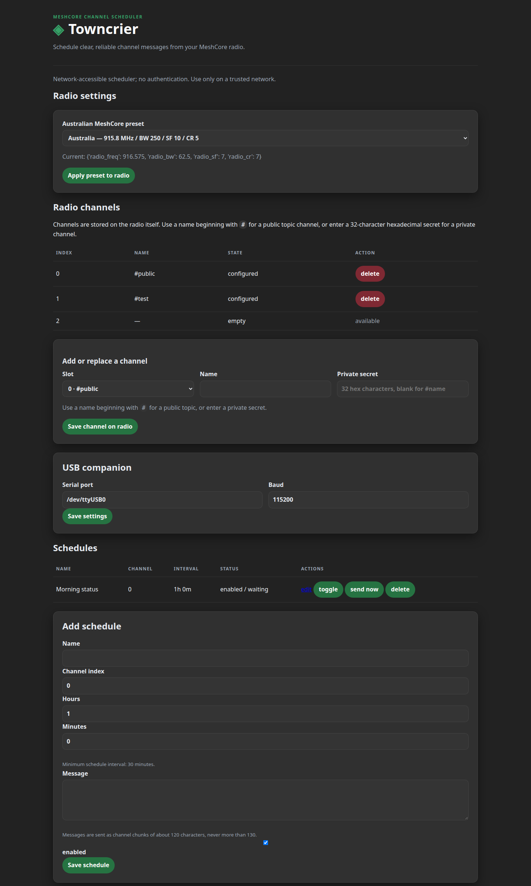

# Towncrier

Towncrier schedules messages to MeshCore **channels** through a USB-connected companion radio. It runs as a Linux background service and has a simple web page for setup.

This guide assumes this is your first time using a Linux desktop and a terminal.



*The page is split into simple sections: radio settings, channels, USB connection, and schedules.*

## What you need

- A Linux computer with a desktop and a web browser.
- A MeshCore companion radio connected with a USB cable.
- An internet connection during installation so Python can download `meshcore`.
- An account that is allowed to use `sudo` (the installer needs administrator permission).

The web page is available to other devices on the same network and has no login. Treat it as an administrator page: use it only on a trusted private network, and do not forward port 8080 from the internet.

## 1. Open a terminal

A terminal is a window where you type commands. On most Linux desktops, press `Ctrl` + `Alt` + `T`. You can also open the application menu, search for **Terminal**, and click it.

Commands below are typed into that window. Press **Enter** after each command. When Linux asks for your password, type the password you use to log in; the characters will not appear while you type. Press **Enter** when finished.

## 2. Download Towncrier

In the terminal, run:

```bash
cd ~ (to get to the users home directory)
git clone https://github.com/eastmesh/towncrier.git
cd towncrier
```

If `git` is not installed, your distribution may offer an **Install** button in the terminal error. On Debian or Ubuntu, an administrator can install it with:

```bash
sudo apt update
sudo apt install git python3 python3-venv python3-pip
```

## 3. Install and start the service

Make sure the USB radio is connected, then run:

```bash
./install.sh
```

The installer:

1. Checks that the computer is Linux and has Python 3.10 or newer, pip, venv, and systemd.
2. Creates the system account `towncrier` if it does not already exist.
3. Adds that account to the `dialout` serial-device group and, when the connected device uses another Linux group, to that device group too.
4. Installs Towncrier under `/opt/towncrier`.
5. Creates `/var/lib/towncrier` for the database and gives it to the service account.
6. Installs the `meshcore` Python library.
7. Installs the systemd service, enables it to start at boot, and starts it now.

When it finishes, open your normal web browser (Firefox, Chrome, Chromium, or similar) on the Towncrier computer and enter:

```text
http://127.0.0.1:8080/
```

`127.0.0.1` means “this computer”. It does not mean a website on the public internet.

### Open it from another computer or phone

Towncrier listens on all network interfaces on port `8080`. To find the Linux computer's local network address, open a terminal on that computer and run:

```bash
hostname -I
```

Choose the address belonging to your home or office network, often something like `192.168.1.25`. On the other computer or phone, connect to the same network, open a browser, and enter:

```text
http://192.168.1.25:8080/
```

Replace `192.168.1.25` with the address shown on your computer. If a firewall is enabled, allow port 8080 only on the trusted local-network profile. Do not use a public IP address, router port forwarding, or an internet-facing reverse proxy unless authentication and HTTPS are added first.

## 4. Find the USB serial device

The radio usually appears as `/dev/ttyUSB0` or `/dev/ttyACM0`. To see possible device names, return to the terminal and run:

```bash
ls /dev/ttyUSB* /dev/ttyACM* 2>/dev/null
```

If you see one device, enter that exact name in the **Serial port** box on the Towncrier page. If you see no device:

- Check that the USB cable carries data, not only power.
- Unplug and reconnect the radio.
- Try another USB port.
- Run the `ls` command again.
- Check the service log with `sudo journalctl -u towncrier -n 50`.

The installer adds `towncrier` to `dialout`. If the service still cannot open the device, restart the service after installation with:

```bash
sudo systemctl restart towncrier
```

## 5. Configure the radio

On the Towncrier page, the **USB companion** section contains:

- **Serial port**: the device path, for example `/dev/ttyUSB0`.
- **Baud**: normally `115200`. Only change this if your companion radio documentation specifies another value.

Click **Save settings**. The settings are stored in `/var/lib/towncrier/towncrier.db` and remain after a reboot.

### Choose a radio preset

The **Radio settings** section contains the official MeshCore Australian suggestions:

- **Australia** — 915.800 MHz, BW 250, SF10, CR5
- **Australia (Narrow)** — 916.575 MHz, BW 62.5, SF7, CR7
- **Australia (Mid)** — 915.075 MHz, BW 125, SF9, CR5
- **Australia: SA, WA** — 923.125 MHz, BW 62.5, SF8, CR8
- **Australia: QLD** — 923.125 MHz, BW 62.5, SF8, CR5

Choose the preset used by nearby MeshCore users and repeaters, then click **Apply preset to radio**. The radio may briefly disconnect while it applies the change; Towncrier reconnects and verifies the settings. Do not choose a different regional preset unless it matches the network you want to use.



## 6. Configure radio channels

The **Radio channels** section reads the channel slots directly from the connected radio. These settings are not only local Towncrier labels; saving or deleting a channel sends the change to the radio.

To add or replace a channel:

1. Enter a channel index from `0` to `255`.
2. Enter a channel name of up to 32 bytes.
3. For a public topic channel, use a name beginning with `#`, such as `#weather`, and leave the secret blank. MeshCore derives the topic key from that name.
4. For a private channel, enter exactly 32 hexadecimal characters as the secret. Treat this value like a password and do not share it publicly.
5. Click **Save channel on radio**.

The channel list displays configured channels without displaying private secrets. Click **delete** to clear a channel slot on the radio. MeshCore implements deletion by writing an empty name and an all-zero secret. Do not delete a channel that is still used by a schedule; change or disable that schedule first.

The page reads up to 40 radio channel slots when it loads. Channel indices are validated locally, and the radio remains the source of truth.

## 7. Add a scheduled message

Use the **Add schedule** form:

- **Name**: a short label you will recognise, such as `Morning status`.
- **Channel index**: the numeric MeshCore channel slot, from `0` to `255`. This is the channel index configured on the companion radio, not the channel name.
- **First send time (local)**: the first message is scheduled for this time in the Towncrier computer’s local timezone. If the time has already passed today, it is scheduled for tomorrow. After the first send, the configured interval determines subsequent sends.
- **Hours** and **Minutes**: how often to send the message after its first send. The smallest allowed value is 30 minutes. For once per hour, enter `1` hour and `0` minutes. Minutes must be from `0` to `59`.
- **Messages**: add one or more texts (up to 500 characters each). Drag messages to change their send order; the order is saved with the schedule. Towncrier automatically sends long messages as channel chunks, aiming for about 120 characters per part and never exceeding 130 characters per part.
- **Enabled**: leave checked for the scheduler to send it. Uncheck it when you want to keep the message without sending it.

Click **Save schedule**. The schedule table shows the next send date and time for enabled schedules, and “Paused” for disabled schedules. Existing schedules created with the older seconds-based interface are raised to the new 30-minute minimum automatically.

The schedule table shows whether an item is enabled, its last status, and the most recent error. The available actions are:

- **edit**: load the schedule into the form.
- **toggle**: enable or disable it.
- **send now**: send one copy immediately without changing its normal timer.
- **delete**: permanently remove it.

A safe first test is:

1. Choose an unused slot, such as `2`.
2. Enter `#test` as the name.
3. Leave **Private secret** blank.
4. Click **Save channel on radio**.
5. Create a schedule using channel index `2`, a 30-minute interval, and a short message.
6. Click **send now** in the schedule table.
7. Watch the radio and the schedule status. A successful send changes the status to `sent`; an error is shown in the table.

Use a different slot if it is already configured. Do not delete or replace a channel used by another schedule unless that change is intentional.

A failed radio send is recorded as an error. Towncrier does not advance the timer after a failed send, so it will try again rather than silently losing the message.

## 8. Check or control the service

To see whether it is running:

```bash
systemctl status towncrier
```

Press `q` to leave the status screen.

To watch recent messages and errors:

```bash
sudo journalctl -u towncrier -f
```

Press `Ctrl` + `C` to stop watching the log.

Useful controls:

```bash
sudo systemctl restart towncrier   # restart after changing hardware or settings
sudo systemctl stop towncrier      # stop sending and stop the web page
sudo systemctl start towncrier     # start it again
sudo systemctl disable towncrier   # do not start automatically at boot
sudo systemctl enable towncrier    # start automatically at boot
```

## Troubleshooting

### The page does not open

Run:

```bash
systemctl status towncrier
sudo journalctl -u towncrier -n 50
```

If the service is stopped, run `sudo systemctl restart towncrier` and try `http://127.0.0.1:8080/` again. Another program may already be using port 8080; the log will show the error. For another device, also confirm it is on the same network and try the Linux computer's address from `hostname -I`.

### The page opens but messages are not sent

Check the serial port spelling, baud rate, radio power, companion firmware, and channel index. Use **send now** once while watching the log. A successful send changes the schedule status to `sent`; a failed send shows `error` and the reason in the table/log.

### The radio device changes name after reboot

Some Linux systems assign a different `/dev/ttyUSB*` or `/dev/ttyACM*` number when several USB serial devices are present. Prefer the stable path shown by:

```bash
ls -l /dev/serial/by-id/
```

Choose the link whose name identifies your MeshCore radio and paste that full `/dev/serial/by-id/...` path into Towncrier. Reconnect the radio, run the command again, update the Serial port field, and save it.

### Permission denied or the remote terminal cannot open the radio

Only one program can use a USB serial radio at a time. Stop Towncrier before opening the same radio with another terminal or companion tool:

```bash
sudo systemctl stop towncrier
# use the other radio tool here
sudo systemctl start towncrier
```

Check who owns the device:

```bash
sudo fuser -v /dev/ttyACM0
id towncrier
```

The installer adds Towncrier to `dialout` and to the group currently assigned to the configured serial device. Restart Towncrier after group membership changes.

## 11. I want to remove Towncrier

Stop and disable it first:

```bash
sudo systemctl disable --now towncrier
sudo rm /etc/systemd/system/towncrier.service
sudo systemctl daemon-reload
sudo rm -rf /opt/towncrier
```

The schedules database is kept at `/var/lib/towncrier/towncrier.db` until you remove it explicitly.

## Development and tests

```bash
python3 -m venv .venv
.venv/bin/pip install -e .
.venv/bin/python -m unittest discover -s tests -v
.venv/bin/python -m compileall -q towncrier
.venv/bin/python -m towncrier --db /tmp/towncrier.db
```

The first version supports USB serial only. BLE, TCP, multi-user authentication, cloud hosting, and public network exposure are intentionally out of scope.
